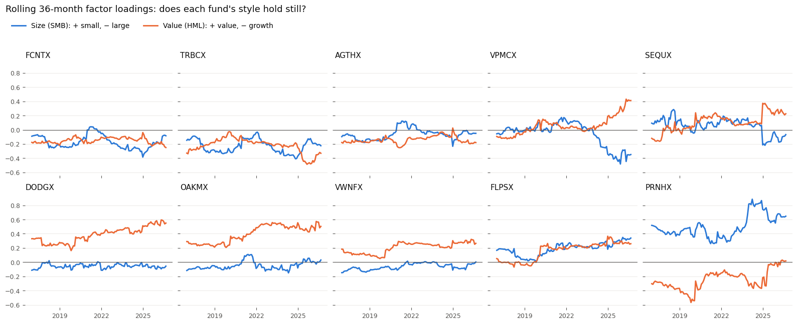

# Manager-Integrity-Check

# Manager Integrity Check

**Does an active fund manager do what it says it does?**

A pension plan that hires external managers has to keep checking that each one is still running the strategy it was hired for. This project builds a small version of that monitoring from public data. It measures what ten active US equity funds actually did, reads what their prospectuses say they do with two LLMs under explicit controls, and flags where the two disagree.

**Status (22 November 2026):** Part 1, the measured side, is complete and its data is reconciled against published returns. Parts 2 and 3 are built and tested; the final extraction run and human verification of every extracted value are in progress, and their results will be added here soon.

## Findings so far

Ten active US equity mutual funds, monthly data from February 2014 to September 2026 (152 months).

- **No manager shows skill that can be told apart from noise.** Six of the ten beat their benchmark ETF on raw return, but none has a statistically significant six-factor alpha: the largest t-statistic in absolute value is 1.41, and it belongs to a negative alpha. The return differences are explained by style exposures, which is exactly why style monitoring matters.
- **The benchmark changes the verdict.** Fidelity Contrafund trailed the Russell 1000 Growth ETF by 0.5 percentage points a year, but beat the S&P 500, the index its own prospectus names, by 1.7 points a year.
- **Fidelity Low-Priced Stock behaves like a mid-cap value fund.** Its size loading is 0.25, against 0.84 for the small-cap value ETF; its beta to that ETF is 0.66 and its tracking error 9.2%, the highest in the sample. Against a small-cap value benchmark, its 59% downside capture flatters it.
- **Sequoia is the clearest outlier.** It trailed the S&P 500 by 5.5 points a year, captured 108% of the index's losses in down months but only 85% of its gains in up months, and has the lowest R² in the sample (0.74), the mark of a concentrated portfolio.
- **The value managers do what they say.** Dodge & Cox Stock and Oakmark load more heavily on value than the Russell 1000 Value ETF itself (0.37 against 0.29), with t-statistics of 7.5 and 6.7.

## How it works

### Part 1: measured behaviour

- **Data.** Monthly total returns from Yahoo Finance, adjusted for dividends and capital-gain distributions, and the Fama-French five factors plus momentum from Ken French's data library. Calendar-year returns for Dodge & Cox Stock (2023) and Fidelity Contrafund (2023 to 2025) match the figures published in their prospectuses to within 0.1 percentage points, so the adjusted prices handle distributions correctly.
- **Scorecard.** Annualised return, excess return, tracking error, information ratio, up and down capture, maximum drawdown, and a six-factor regression with Newey-West standard errors. The regression is written out in NumPy and checked against `statsmodels`.
- **Style.** The same regression run on nine index ETFs (large, mid and small; growth, blend and value) rebuilds the style box from returns alone. Each fund takes the box of the ETF it sits closest to, and a label is marked borderline when the second-closest box is almost as near.
- **Drift.** Factor loadings re-estimated over rolling 36-month windows.

### Part 2: stated mandate, extracted with controls

Two LLMs (Gemini models on the free tier) read each fund's prospectus and fill a fixed schema: objective, size and style focus, geographic scope, foreign limit, benchmark indexes, expense ratio and turnover. The controls:

1. Fixed fields with allowed values.
2. A word-for-word quote for every value, checked against the document.
3. "Not stated" preferred over guessing; no inferring style from a fund's name.
4. Two models, with disagreements reviewed first.
5. Required fields: "not stated" on the objective, expenses, turnover or benchmark counts as a failure.
6. Human verification of every value in an Excel workbook, with each model's accuracy measured against it.
7. An audit trail: every raw response saved with the model, a document hash and a timestamp.

### Part 3: stated vs measured

Five checks per fund: size, style, how much of the fund US factors explain, the benchmark, and stability over time. A flag is a question to put to the manager, not a verdict. The benchmark check tests my choice of proxy rather than the manager, so it doesn't count towards a fund's overall flag.

## What I got wrong, and fixed

- **Fragile style labels.** My first rule used round-number cut-offs, and four of the ten labels sat within 0.01 of one. I replaced it with the nearest-index rule above, calibrated on the nine ETFs.
- **A checker that blamed the wrong model.** The stronger model's quotes failed the evidence check far more often. Every failure came from two Vanguard prospectuses whose PDF text had no spaces between words: the smaller model copied the broken text, the stronger one quoted it correctly, and my word-based check couldn't match it. Evidence is now matched on characters as well as words.
- **A silent failure.** One PDF had no readable text, so both models answered "not stated" for everything, which looked like agreement. Required fields now catch this.
- **Index names.** "Standard & Poor's 500" wasn't recognised as the S&P 500. Each benchmark now has a list of the names it goes by.

## Limitations

- **Survivorship bias.** Every fund in the sample still exists; funds closed after poor results are invisible.
- **Public returns, not holdings.** A pension plan sees holdings data from its managers; returns-based analysis detects a change in style later than holdings would.
- **Proxies.** Benchmark ETFs carry small fees and tracking differences, and US factors say nothing about a fund's foreign exposure.
- **Labels are relative.** Style labels depend on the reference ETFs, and a prospectus describes what a fund may do, which is broader than what it does.
- **Model independence.** Both models are from Google, so their mistakes are more likely to coincide than with two providers; human verification covers that gap.
- **Document editions.** Two prospectuses are 2024 editions: Growth Fund of America (the current edition's PDF has no extractable text, so the November 2024 summary prospectus from SEC EDGAR is used) and Dodge & Cox Stock (the May 2024 prospectus covering all Dodge & Cox funds).

## Run it

1. Open `Manager_Integrity_Check.ipynb` in Google Colab.
2. Add a Gemini API key from Google AI Studio to Colab Secrets as `GEMINI_API_KEY`, with notebook access on. The free tier is enough.
3. Run all. When asked, upload each fund's summary prospectus, named by ticker (`DODGX.pdf` and so on).
4. Download `outputs/verification_workbook.xlsx`, verify each value, save it as `verification_completed.xlsx` in `outputs/`, and run all again.

## Repository

- `Manager_Integrity_Check.ipynb`: the full analysis. Part 1 is shown with its outputs.
- `outputs/scorecard.csv`: the full risk and performance scorecard.
- `outputs/benchmark_calibration.csv` and `outputs/measured_style.csv`: the style-box calibration and each fund's measured style.
- `outputs/data_quality.csv` and `outputs/calendar_year_returns.csv`: the data checks.
- `outputs/rolling_loadings.png`: style drift over time.
- Coming with Parts 2 and 3: the verification workbook, the saved model responses, the stated-vs-measured table, the style map and a two-page investment committee memo.

Prospectuses are public and not included; each fund's summary prospectus is on its manager's website.

---

Cher Eze · cherieeze@gmail.com
